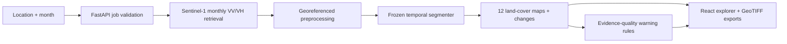

# SARScope

**Satellite radar · Monthly land-cover intelligence · Research-grade provenance**

SARScope is a geospatial analysis system that fetches **historical Sentinel-1 SAR imagery**, generates twelve monthly nine-class land-cover predictions using a **fixed temporal segmentation model**, and provides explorable, georeferenced outputs with evidence-quality warnings. A React viewer, FastAPI service, CPU inference engine, evaluation records and an offline three-region explorer share one VS Code-ready repository.

> **Research boundary:** prediction maps are **not ground truth**. Held-out evaluation used Dynamic World-derived weak labels: **74.17% overall accuracy / 42.39% mean IoU**. Geographic extrapolation to 2025–2026 has not been independently validated. This is not a real-time feed, a building footprint detector, or a certified change monitor.

## Windows 11: publish and run

See **[WINDOWS_GITHUB_SETUP.md](WINDOWS_GITHUB_SETUP.md)** for the tested local workflow: one-command public GitHub repository creation from the authenticated Windows PC, project clone/pull, verified checkpoint import, Earth Engine sign-in, and local dynamic analysis. The included `PUBLISH_PUBLIC.cmd` publisher refuses unexpected GitHub accounts, detects common secrets, and never commits the private runtime model or large rescue archives.

## Start in one minute

1. Open this repository folder in **VS Code**.
2. On Windows, run `01_START.cmd` for the saved-case viewer. On macOS/Linux, follow [local development](docs/development.md).
3. Open `http://127.0.0.1:8765` (or `http://127.0.0.1:8765/quality` for the quality explorer), then explore **Mannheim, Cairo, Mauritania and Queens**. Saved results require no cloud login.
4. For the standalone three-region visual report, open [`docs/index.html`](docs/index.html). It works offline without a backend.
5. To process a **new** location, install the original verified trained checkpoint, Python inference libraries and Earth Engine credentials as described in [model and data](docs/data-and-model.md). **The model weights are not included in the recovered exports.**

## How it works



This system uses a real trained architecture and checkpoint loader (`engine/model.py`). The runtime checks checkpoint SHA-256 and prepared normalization metadata before enabling real inference. When assets are absent, the application remains a **saved-case viewer**, never silently replacing the model with random weights or synthetic maps.

## Project structure

```text
SARScope/
├── backend/            # FastAPI routes, worker and quality diagnostics
├── engine/             # Frozen checkpoint loader, geospatial inference, preprocessing
│   ├── evidence/       # Reproducibility manifests and model selection evidence
│   └── vendor/         # Reviewed baseline and Earth Engine helpers
├── frontend/           # React + TypeScript + Vite; dist/ is saved-case UI
├── models/             # Model card and exact frozen checkpoint identity (no weights)
├── sample/             # Four saved cases, PNGs, georeferenced GeoTIFFs, receipts
├── evidence/           # Frozen held-out evaluation records
├── research/           # Report, executed notebooks, provenance and data audit
├── docs/               # Architecture, setup, deployment, standalone GitHub Pages demo
├── scripts/            # Model import/download and pre-push audit
├── tests/              # Offline backend regression suite
├── .github/workflows/  # CI and optional Pages publish
├── .vscode/            # Debug launch configs, tasks and extensions
├── Dockerfile          # Read-only demo image
├── compose.yaml        # Loopback Docker preview
└── serve.py            # Local app entrypoint
```

## System modes

| Mode | Requires weights | Requires Earth Engine | What it does |
|---|---:|---:|---|
| Static GitHub Pages report | No | No | Interactive inspection of saved Cairo, Mauritania, Queens maps |
| Local saved-case viewer | No | No | React/FastAPI viewer with Mannheim and three exported cases |
| Local trusted inference | Yes, verified | Yes, authorized | New coordinate/date queries, 12 predictions and real exports |
| Public dynamic inference | Not released | Not released | Requires access controls, durable worker services, security review |

## Model and data availability

The supplied source and saved-case exports contain **model code, recorded identities, and results**, but **not** the original `best.pt` weight bytes or the full prepared training dataset. This repository keeps those large / access-sensitive assets outside source control. See [`models/MODEL_CARD.md`](models/MODEL_CARD.md), [`scripts/model_assets.py`](scripts/model_assets.py), and [`docs/data-and-model.md`](docs/data-and-model.md) for the verified restore path. No fake checkpoint is substituted.

## Evidence and known limitations

- Cairo: high built-up prediction share in the selected area. A visually red map is a model output, not necessarily a display defect.
- Mauritania: snow/ice spike in October 2026 demonstrates class confusion and needs independent references.
- Queens: several months have sparse radar scene support; full label coverage is not evidence of high accuracy.
- Scene counts, entropy, dominance, and change warnings are **descriptive heuristics**, not calibrated error probabilities.

The original findings, evaluation and reproducibility notes are in [architecture](docs/architecture.md), [reliability notes](docs/reliability-notes.md), and [research report](research/report/SARScope_Report.md).

## Reproducibility and quality

```bash
python -m pip install -r requirements-viewer.txt
python -m unittest discover -s tests -v
python scripts/repository_audit.py
python scripts/model_assets.py status
```

These tests exercise API behavior, saved cases and source-quality rules without requiring model weights. CI additionally rebuilds the React UI. A **fresh authenticated Sentinel-1 inference** can only be validated where the genuine checkpoint and Earth Engine account are available.

## Sharing and deployment

The repository is designed for **GitHub** and a GitHub Pages static demonstration, with an optional Docker read-only preview. See the exact commands and security boundaries in [`docs/deployment.md`](docs/deployment.md). Publishing this ZIP does **not** itself create any live link. Model weights / training data must be distributed separately through authorized artifact storage if sharing is permitted.

**Research provenance:** all saved prediction examples are preserved; deployment scaffolding and review metadata do not retrain the frozen model. Check actual source terms and data licenses before open publication.
