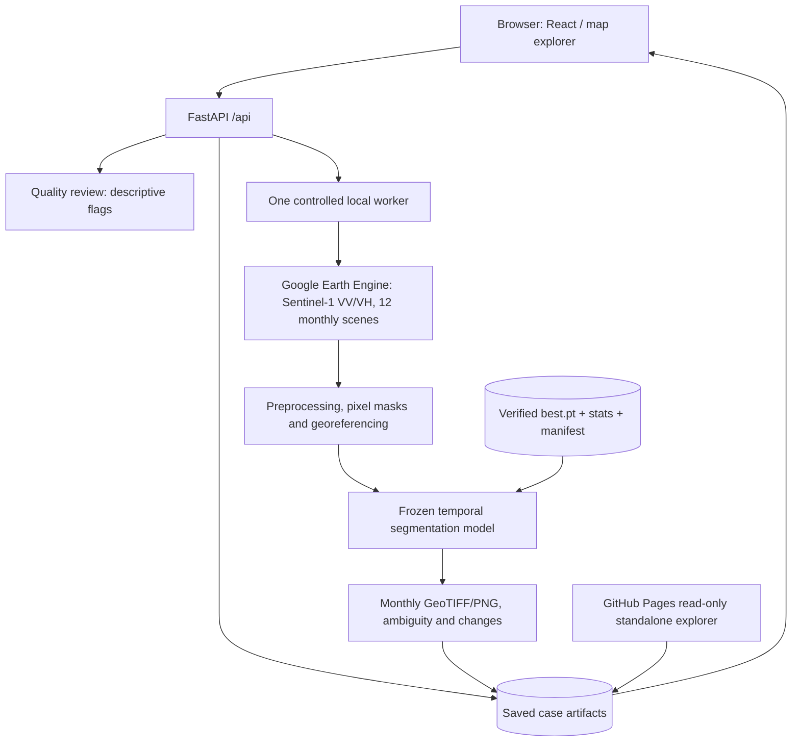

# Architecture and data lifecycle

## Contracts and responsibility boundaries

1. **Frontend** (`frontend/src`): coordinate inputs, case selection, 12 monthly comparisons, legends and charts, acquisition observations, export links, quality warnings. `frontend/dist` is a prebuilt viewer for offline setup; CI also rebuilds TypeScript sources.
2. **API** (`backend/server.py`): validates locations/date windows; serves previously saved cases; allows only one local inference worker. In public-preview mode, all write operations are denied.
3. **Acquisition and analysis** (`engine/pipeline.py`, `backend/acquisition.py`): Earth Engine downloads available historical Sentinel-1 imagery after user authorization. New cases require verified local artifacts and credentials.
4. **Frozen model** (`engine/model.py`): loads only checkpoint and prepared stats with fixed identities, runs CPU FP32 predictions; new training is not launched. It cannot identify individual building footprints.
5. **Artifacts** (`sample/cases`, ignored `workspace/submission_v1/cases`): GeoTIFFs, radar previews, maps, acquisition receipts, class shares, transition matrices, HTML reports, model identity. Examples are original reference case exports.
6. **Quality flags** (`backend/quality.py`): descriptive warnings for limited source support, dominant classes and abrupt monthly changes; not calibrated confidence or certified change events.
7. **Public page** (`docs/index.html`): standalone static reproduction of the three previously exported sites, not connected to live API or Earth Engine.

## Security boundary

Keep authenticated inference on **localhost or behind a genuine authentication proxy on a trusted VM**. Never expose the existing write API publicly on the strength of an `x-sarscope-local` header. Public GitHub Pages and the supplied container run in read-only mode. The full checkpoint and Earth Engine authorization remain on trusted machines or private artifact storage, not in the website or image.

## Scientific boundary

- 10 m is the approximate source pixel footprint, not an accuracy guarantee or a building-resolution detector.
- A radar scene count describes intersecting scenes, not per-pixel independent observations.
- All model maps are predictions. Dynamic World weak-label scores are not independent accuracy assessments.
- Dates are retrospective complete calendar months, not a real-time satellite feed.
